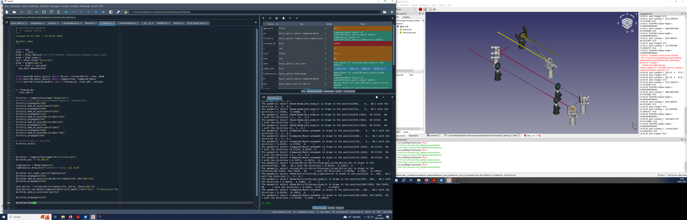
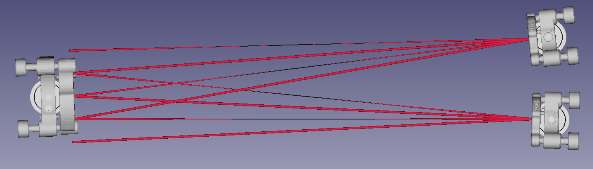
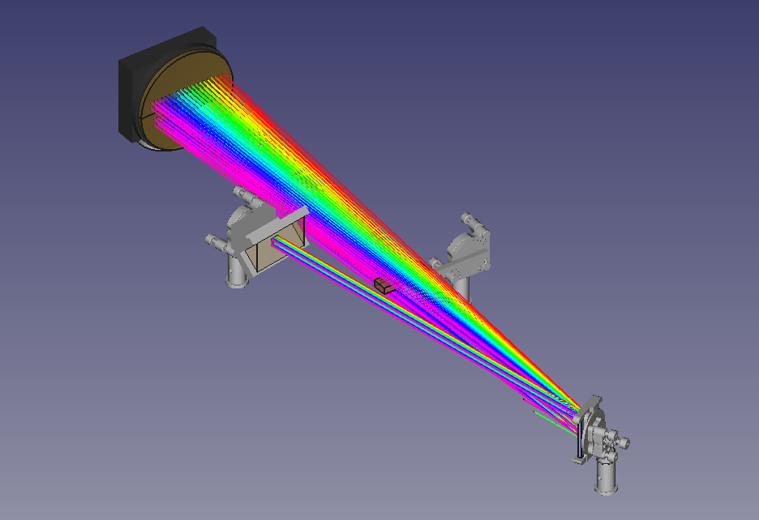

# LaserCAD

Authors: Clemens Anschütz (clemens.anschuetz@uni-jena.de),
Martin Beyer (m.beyer@uni-jena.de), He Zhuang (he.zhuang@uni-jena.de)

Procrastination next level!

LaserCAD helps you to quickly prototype and script your optical setup with as
few commands as possible, in the language of geometric optics and with a ton of
default values. It approximates the ray tracing (ray optics, ABCD matrices for
beams) and shows you a 3D view of everything in [FreeCAD](https://www.freecad.org).

The creed is:
1. Make the common case simple.
2. The user should be able to set everything in the script, but the default
   values should be so well chosen that it is not necessary.
3. The code should be designed in such a way that you know where to reprogram
   something if necessary. (OK, let's see.)

## A first example

```python
from LaserCAD.basic_optics import Beam, Composition, Lens, Mirror
from LaserCAD.freecad_models import freecad_da, clear_doc

if freecad_da:
  clear_doc()

setup = Composition(name="first_setup")
setup.set_light_source(Beam(radius=2, angle=0))   # 4 mm collimated beam
setup.propagate(100)                              # 100 mm of free space
setup.add_on_axis(Lens(f=200))                    # the lens sits on the axis
setup.propagate(200)
setup.add_on_axis(Mirror(phi=90))                 # fold the beam by 90 degrees
setup.propagate(100)
setup.draw()                                      # 3D view in FreeCAD
```

The same script runs in a plain Python interpreter (it only prints what would
be drawn) and in FreeCAD (it creates the 3D model).

## Conventions

- Lengths are in **millimetres**, wavelengths too (800 nm = `800e-6`), angles
  of mirrors and mounts in **degrees**.
- The default position of every object is `(0, 0, 80)` and the default
  direction is `(1, 0, 0)`: the beam travels along *x*, *z* is the height above
  the table (80 mm), the table is the *x*-*y* plane.
- `pos` and `normal` are **not** accepted as constructor arguments (a warning is
  printed and they are ignored). Create the objects first (they all start at the
  default position) and move them afterwards by setting `obj.pos` and
  `obj.normal`. Compositions do this for you when you use `propagate` and
  `add_on_axis`.
- Unknown keyword arguments in a constructor also produce a warning, so typos
  like `aperure=25` do not pass silently.

## Installation

1. Install [FreeCAD](https://www.freecad.org/downloads.php) (only needed for
   the 3D view) and Python 3.
2. Get the code:
   ```
   git clone https://github.com/klee-mens/LaserCAD.git    # or use GitHub Desktop
   ```
3. Optional but recommended, create a virtual environment in the project folder:
   ```
   python -m venv ./venv
   ./venv/Scripts/activate        # Windows
   source ./venv/bin/activate     # Linux
   ```
4. Install the requirements. The last line of `requirements.txt` installs
   LaserCAD itself in editable mode, so changes in the source files are
   effective immediately and no `PYTHONPATH` is needed.
   (For Spyder also install `spyder-kernels`.)
   ```
   python -m pip install -r requirements.txt
   ```
5. Run `manual/tutorial/0_Opening.py` in your interpreter. The output ends with
   something like
   ```
   The geometric object <Composed_Mount:unnamed> is drawn to the position[108.51854, 264.70476,  80.     ] with the direction [-0.95766,  0.2566 , -0.13053]
   ```
   Executing the same file in FreeCAD as a macro (green arrow or F6) creates a
   new document with the 3D model:



### FreeCAD uses its own Python

FreeCAD has its own Python interpreter and its own search paths, so the
`pip install` above does not reach it. Tell FreeCAD where LaserCAD lives with
a macro:

1. Macro -> Macro recording..., click record and stop immediately.
2. Edit the new macro (Macro -> Macros... -> Edit) and replace its content by
   ```python
   import sys
   sys.path.append('C:/path/to/LaserCAD/')    # the folder that contains the LaserCAD package
   ```
3. Run this macro once per FreeCAD session. You can pin it to the toolbar
   (Macro -> add to toolbar). `LaserCAD-Init.FCMacro` in this repository is an
   example.

The same works for Spyder if it uses another environment: Tools ->
Preferences -> Python interpreter.

### Uninstall

```
python -m pip uninstall LaserCAD
```
Then delete the `venv` and `LaserCAD.egg-info` folders and the repository.

## Documentation

The `manual` folder follows the [Divio documentation system](https://docs.divio.com/documentation-system/);
see `manual/README.md`:

- Tutorials (`manual/TutorialLaserCAD.md`, scripts in `manual/tutorial`)
- How-to guides (`manual/how_to_*.md`), e.g. a stretcher and a white cell
- Reference of all classes, generated from the code (`manual/reference`)
- Discussion (`manual/docs`)

## Tests

```
python -m unittest discover -s tests/unit     # fast, physics based unit tests, no FreeCAD needed
python -m unittest discover -s tests/smoke    # runs all demo scripts and tutorials (about 2 minutes)
```

See `tests/README.md` for details. The scripts directly in `tests/*.py` and
`WORK` are demo scripts to look at the result in FreeCAD.

## Some examples

White cell and stretcher, see the how-to guides:





Have fun!
